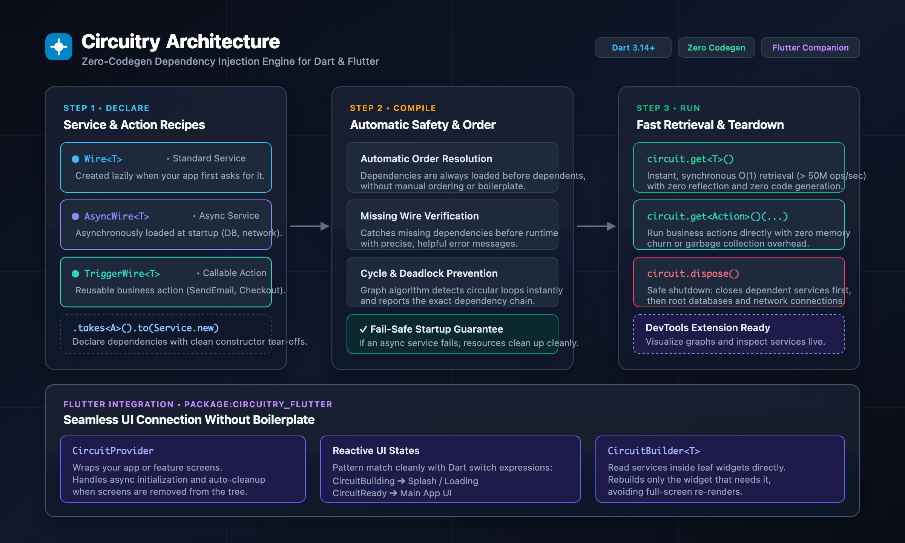

# Circuitry

> **Pure Dart 3.14+ zero-codegen, graph-based dependency injection engine backed by a Directed Acyclic Graph (DAG), with Flutter bindings.**

Circuitry provides compile-time-checked runtime dependency wiring with parallel topological wave resolution for asynchronous singletons, reverse topological wave disposal, and type-safe dependency chaining without code generation, mirrors, or reflection.

---

## Monorepo Packages

| Package | Version | Description |
| --- | --- | --- |
| [`circuitry`](packages/circuitry) | [](https://pub.dev/packages/circuitry) | Pure Dart dependency injection engine. Zero Flutter dependencies; runs on CLI, server, web, and mobile. |
| [`circuitry_flutter`](packages/circuitry_flutter) | [](https://pub.dev/packages/circuitry_flutter) | Flutter bridge with `CircuitProvider`, `InheritedWidget` scoping, `CircuitState` matching, and unmount disposal. |

---

## Architecture Overview



---

## Architectural Principles

1. **Zero Codegen & Pure Dart 3.14+**: No `build_runner`, code generation steps, or reflection. Fully leverages Dart 3.14+ primary constructors, switch expressions, and record tuple keys `(Type, Enum?)`.
2. **DAG Static Validation**: Validates the dependency graph during `Circuit.build(wires)` before creating singletons:
   - Duplicate wire keys throw `DuplicateWireException`
   - Missing dependencies throw `MissingWireException`
   - Cycles throw `CircularDependencyException` with exact cycle paths
3. **Parallel Topological Wave Resolution**: Asynchronous singletons (`AsyncWire<T>`) resolve concurrently wave-by-wave using `Future.wait` with fail-fast semantics (`eagerError: true`). Immediately rolls back and disposes partially created instances in reverse topological order if any wave fails.
4. **Type-Safe Accumulator Chaining**: Chain dependencies with `.takes<A>()` and `.takesTagged<B, K>(tag)` producing strongly-typed accumulators. Direct tear-offs (`.to(UserService.new)`) or destructuring for multi-dependencies.
5. **Reverse Topological Wave Disposal**: Idempotent teardown in reverse dependency waves (`leaves -> roots`), awaiting asynchronous `onDispose` callbacks concurrently and aggregating errors into `DisposalException`.
6. **Flutter Lifecycle Integration & Scoped Registries**: `CircuitProvider` manages async build lifecycles, didUpdateWidget monotonic compilation epoch race prevention, unmount teardown, and ambient `Map<Enum, Circuit>` scoping for nested tagged providers with **O(1)** retrieval (`CircuitProvider.of(context, tag: Scope.global)`).
7. **On-Demand Introspection & Exporters**: `circuit.inspect()` provides on-demand DAG inspection (`dependentsOf`, `dependenciesOf`, `topologicalOrder`), valid Mermaid flowchart generation (`toMermaid()`), and structured JSON serialization (`toJson()`), fully tree-shaken in release builds when unused.
8. **DevTools Integration & Universal Extension Host**: Ambient `CircuitRegistry` tracks containers in debug mode, exposing VM Service endpoints (`ext.circuitry.getCircuits`, `ext.circuitry.getCircuitGraph`) and streaming lifecycle events via `developer.postEvent`. Preconfigured `extension/devtools/config.yaml` provides universal DevTools extension discovery across CLI, server, and Flutter runtimes.

---

## Workspace Structure

```
circuitry/
├── .github/workflows/ci.yml       # Automated format, analyze, and test verification
├── docs/
│   ├── decisions.md               # Architectural decision records
│   ├── architecture.md            # System architecture, module tree, and seams
│   └── plan.md                    # Active roadmap and checklist
├── packages/
│   ├── circuitry/                 # Pure Dart dependency injection engine
│   │   ├── extension/             # Dart & Flutter DevTools extension configuration
│   │   ├── lib/
│   │   │   ├── circuitry.dart     # Public barrel export
│   │   │   └── src/               # Core engine implementation (circuit, graph, wire, registry, utils, extensions)
│   │   └── test/                  # Unit tests for DAG, waves, laziness, disposal, and registry
│   └── circuitry_flutter/         # Flutter companion package
│       ├── lib/
│       │   ├── circuitry_flutter.dart # Public barrel export
│       │   └── src/               # Flutter bridge implementation (provider, scope, state)
│       └── test/                  # Widget, lifecycle, and integration tests
├── analysis_options.yaml          # Strict static analysis rules
├── pubspec.yaml                   # Root pub workspace
└── README.md
```

---

## Verification & Commands

### Code Formatting

```bash
# Check formatting across all packages
dart format --output=none --set-exit-if-changed .

# Apply formatting
dart format .
```

### Static Analysis

```bash
# Run strict linter across workspace
flutter analyze --fatal-infos --fatal-warnings
```

### Run Tests

```bash
# Run pure Dart tests in circuitry
cd packages/circuitry && dart test

# Run Flutter tests in circuitry_flutter
cd packages/circuitry_flutter && flutter test
```

---

## License

Copyright © 2026 [Raman Verma](https://github.com/maranix). Released under the [MIT License](LICENSE).
