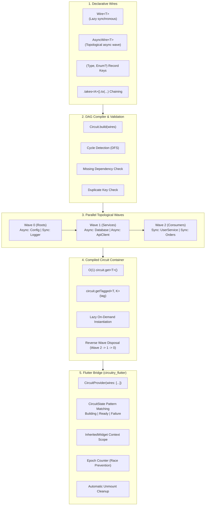
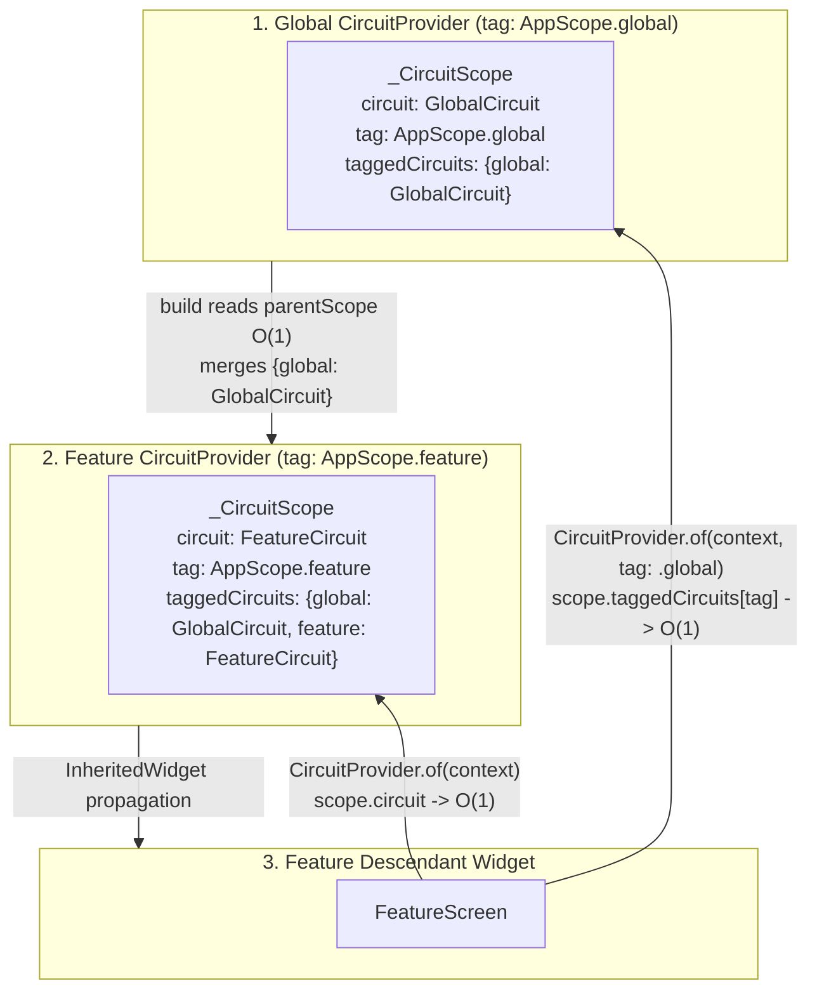

# Circuitry Architecture

## Current Shape & Monorepo Layout

Circuitry is architected as an offline, zero-codegen runtime dependency graph compiler split into packages under a unified Dart workspace:

```
circuitry/
├── packages/
│   ├── circuitry/                 # Pure Dart runtime dependency injection engine
│   │   ├── lib/
│   │   │   ├── circuitry.dart     # Library entry point (wires, circuit, exceptions, introspection, observer)
│   │   │   └── src/               # Modular source files
│   │   │       ├── circuit.dart   # Circuit container and DAG compiler
│   │   │       ├── exceptions.dart# CircuitException hierarchy with primary constructors
│   │   │       ├── introspection.dart # Graph introspection, WireStatus, WireDescriptor, Mermaid/DOT/JSON
│   │   │       ├── observer.dart  # CircuitObserver, CircuitInfo, and _CompositeCircuitObserver
│   │   │       └── wire.dart      # WireKey, CircuitWire, Wire, AsyncWire, builders
│   │   └── test/                  # Unit tests (DAG validation, waves, laziness, disposal, observer, introspection)
│   ├── circuitry_flutter/         # Flutter framework bridge
│   │   ├── extension/
│   │   │   └── devtools/
│   │   │       └── config.yaml    # DevTools extension discovery manifest
│   │   ├── lib/
│   │   │   ├── circuitry_flutter.dart # Library entry point and pure Dart re-export
│   │   │   └── src/               # Flutter bridge implementation
│   │   │       ├── circuit_provider.dart # CircuitProvider widget declarations and internal _CircuitScope
│   │   │       ├── circuit_registry.dart # CircuitRegistry and CircuitEntry debug tracking
│   │   │       ├── circuit_state.dart    # CircuitState sealed hierarchy
│   │   │       └── vm_service_extensions.dart # Developer service extensions for DevTools
│   │   └── test/                  # Widget & lifecycle tests
│   └── circuitry_devtools_extension/ # Flutter DevTools companion extension
│       ├── lib/
│       │   ├── circuitry_devtools_extension.dart # Public barrel export
│       │   ├── main.dart             # Extension entry point with DevToolsExtension
│       │   └── src/
│       │       ├── layout/
│       │       │   └── sugiyama_layout.dart # Sugiyama topological DAG layout engine
│       │       ├── model/
│       │       │   └── circuit_devtools_models.dart # CircuitSummary, WireModel, CircuitGraphData
│       │       ├── service/
│       │       │   ├── circuitry_client.dart # CircuitryClient and MockCircuitryClient
│       │       │   └── vm_service_circuitry_client.dart # VmServiceCircuitryClient
│       │       └── ui/
│       │           ├── circuit_navigator.dart # List & filtering of active circuits
│       │           ├── circuitry_dashboard.dart # Integrated inspection workbench
│       │           ├── dag_canvas.dart      # InteractiveViewer DAG CustomPainter
│       │           ├── wave_profiler.dart   # Gantt waterfall timeline & critical path
│       │           └── wire_drawer.dart     # Node details & force initialize
│       └── test/
│           ├── sugiyama_layout_test.dart
│           └── ui_test.dart                 # Widget tests for extension components
├── docs/
│   ├── decisions.md               # Architectural decision records
│   ├── architecture.md            # Detailed system architecture, seams, and module tree
│   └── plan.md                    # Active roadmap and implementation checklist
├── .github/workflows/ci.yml       # Automated format, analyze, and test verification
├── analysis_options.yaml          # Strict static analysis configuration
├── pubspec.yaml                   # Root pub workspace
└── README.md
```

---

## Visual Architecture




---

## Seams, Layer Boundaries & Decoupling Principles

### 1. Pure Dart Engine Independence
- `packages/circuitry` is completely decoupled from the Flutter SDK and UI frameworks.
- Imports strictly from `dart:core` and `dart:async`.
- Usable across all Dart deployment targets: command-line utilities, backend microservices, server frameworks (Shelf, Dart Frog), web apps, and native apps.

### 2. Flutter Framework Bridge
- `packages/circuitry_flutter` imports `circuitry` and `package:flutter/widgets.dart` / `package:flutter/foundation.dart`.
- Re-exports `package:circuitry/circuitry.dart` so Flutter consumers need only depend on `circuitry_flutter`.
- Encapsulates `InheritedWidget` scoping within `_CircuitScope`, preventing `BuildContext` extension pollution.
- Implements `didUpdateWidget` epoch generation tracking to safely cancel and tear down superseded in-flight compilations when wire inputs change.
- Propagates tagged ancestor circuits via ambient immutable map merging in `_CircuitScope`, enabling descendants across nested scopes to access tagged ancestor circuits in **O(1)** without tree walking.

### 3. Nested Scopes & O(1) Ambient Registry Map Merging
When `CircuitProvider` widgets are nested (e.g., global app provider -> feature provider), descendants often need access to both their local feature container and ancestor containers:
- `CircuitProvider(tag: AppScope.global, ...)` and `CircuitProvider.value(tag: AppScope.feature, ...)` accept an optional `Enum? tag`.
- Each `_CircuitScope` maintains an immutable `Map<Enum, Circuit> taggedCircuits` map, wrapping merged registries in `Map.unmodifiable`. When `tag` is omitted, parent maps are reused directly without allocations:
  ```dart
  final effectiveTaggedCircuits = parentScope?.taggedCircuits ?? const {};
  taggedCircuits: tag != null
      ? Map.unmodifiable(<Enum, Circuit>{
          ...effectiveTaggedCircuits,
          tag!: circuit,
        })
      : effectiveTaggedCircuits,
  ```
- Descendants access containers with true O(1) performance:
  - `CircuitProvider.of(context)`: returns nearest `Circuit` in **O(1)**.
  - `CircuitProvider.of(context, tag: AppScope.global)`: retrieves `scope.taggedCircuits[tag]` in **O(1)**.
- If two nested providers share the same tag, the nearer ancestor lexically shadows the outer ancestor.
- Sibling subtrees maintain isolated registries without leaking into each other.
- When an inner `CircuitProvider` is in `CircuitBuilding` or `CircuitFailure`, it mounts `_CircuitScope(circuit: null, taggedCircuits: parentScope.taggedCircuits)` to properly intercept untagged lookups (returning `null` in `maybeOf` and throwing `StateError` in `of` rather than leaking the outer ancestor circuit) while continuing to provide access to ready ancestor tagged circuits in O(1).



### 4. Record Tuple Keys (`WireKey = (Type, Enum?)`)
- Dependency identifiers are Dart 3 record tuples.
- Untagged dependencies use `(T, null)`.
- Tagged dependencies constrain tags to enum values (`(T, K)` where `K extends Enum`).
- Enables Dart dot-shorthands (e.g. `tag: .prod`, `tag: .fast`) and allows multiple distinct registrations of the same generic Dart type without collisions.

### 5. Declarative Wire Recipes (`CircuitWire`, `Wire<T>`, `AsyncWire<T>`)
- `Wire<T>`: Synchronous lazy singletons, constructed on first read or when required by an `AsyncWire` during build.
- `AsyncWire<T>`: Asynchronous singletons resolved in parallel topological waves during `Circuit.build(wires)`.
- Fluent accumulator chaining (`Wire.takes`, `AsyncWire.takes` backed by internal `WireBuilder` / `AsyncWireBuilder` hidden from public exports) allows type-safe dependency declarations:
  - 1-dependency accumulator passes directly to 1-arg constructor/tear-off (`.to(UserService.new)`).
  - Multi-dependency accumulator unpacks nested record tuples (`(deps) => OrderService(deps.$1, deps.$2)`).

### 6. DAG Static Validation & Parallel Topological Wave Resolution
- `Circuit.build(wires)` executes full DAG validation before instantiation:
  - Duplicate keys throw `DuplicateWireException`
  - Missing dependencies throw `MissingWireException`
  - Cycles throw `CircularDependencyException` with cycle paths
- Resolves `AsyncWire`s in parallel topological waves using `Future.wait`. Automatically tears down partially initialized instances in reverse topological order if any wave throws.

### 7. Reverse Topological Wave Disposal
- `Circuit.dispose()` performs idempotent teardown in reverse topological dependency waves (`leaves -> roots`), ensuring consumers are disposed before their underlying dependencies.
- Executes `onDispose` callbacks concurrently across each level, aggregating failures into `DisposalException`. Subsequent calls are safe no-ops.

### 8. Package Metadata & pub.dev Discovery
- Centralizes project links on `https://github.com/maranix/circuitry` with issues routed to package-specific label queries (`label:circuitry` and `label:circuitry_flutter`).
- Subpackage repository fields are deep-linked to their tree directories (`packages/circuitry` and `packages/circuitry_flutter`) to enable direct file browsing from pub.dev.
- Curates up to 5 lowercase slug discovery topics per package targeting DI, IoC, DAG, Flutter, and architectural workflows.
- Maintains standalone `CHANGELOG.md` and MIT `LICENSE` files within each package to satisfy pub publishing requirements.

### 9. Core Introspection API & Lifecycle Observers
- `circuit.inspect()` returns an immutable `CircuitIntrospection` snapshot enabling bidirectional dependency graph queries:
  - `dependenciesOf(key)`: direct or transitive upstream dependencies required by `key`.
  - `dependentsOf(key)`: direct or transitive downstream dependents that rely on `key`, backed by internal reverse dependency index compiled during DAG validation.
  - `topologicalOrder`: resolved wave order.
  - `statusOf(key)`: real-time `WireStatus` (`unresolvedLazy`, `resolving`, `resolved`, `failed`, `disposed`).
  - `toMermaid()` / `toDot()` / `toJson()`: automated graph diagram export with wave subgraphs and status styling.
  - `findOrphanWires()` and `detectCriticalPath()`: structural linting.
- `CircuitObserver`: Tiered composite lifecycle telemetry (`local ?? Zone.current[#circuitObserver] ?? CircuitObserver.global`) tracking build progress, wave starts/completions, wire resolution durations, and disposal without test leakage.

### 10. Flutter DevTools Extension & VM Service Bridge
- `packages/circuitry_flutter` integrates an ambient `CircuitRegistry` tracking active/tagged circuits mounted in the widget tree.
- Exposes VM Service extensions (`ext.circuitry.getCircuits`, `ext.circuitry.getCircuitGraph`, `ext.circuitry.forceResolveWire`), completely tree-shaken in release builds (`kDebugMode` guarded).
- `packages/circuitry_devtools_extension` provides an interactive DevTools extension panel:
  - **CircuitNavigator**: tree list of detected circuits with tags and lifecycle states.
  - **DagCanvas**: interactive canvas powered by a 4-phase **Layered Sugiyama Layout Engine** (wave columns, median barycentric crossing reduction, cubic Bézier splines), distinct node styling by status, and bilateral dependency edge highlights.
  - **WireDrawer**: inspection panel with click-to-focus navigation and on-demand "Force Initialize" for lazy wires.
  - **WaveProfiler**: waterfall Gantt timeline of async wave resolution highlighting critical path bottlenecks.
- Discovered automatically by Flutter DevTools via `packages/circuitry_flutter/extension/devtools/config.yaml`.

---

## Verification & Commands

```bash
# Workspace format check
dart format --output=none --set-exit-if-changed .

# Workspace static analysis
flutter analyze --fatal-infos --fatal-warnings

# Run all unit tests for pure Dart circuitry
cd packages/circuitry && dart test

# Run all widget & lifecycle tests for circuitry_flutter
cd packages/circuitry_flutter && flutter test

# Run all tests for DevTools extension
cd packages/circuitry_devtools_extension && flutter test
```
