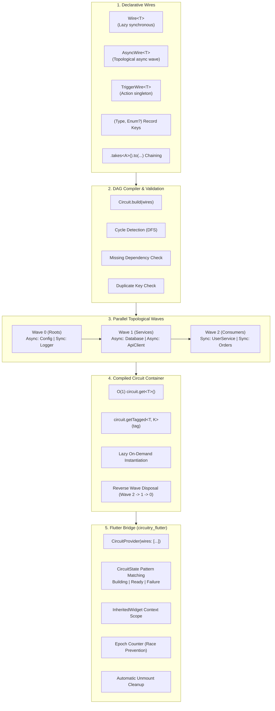
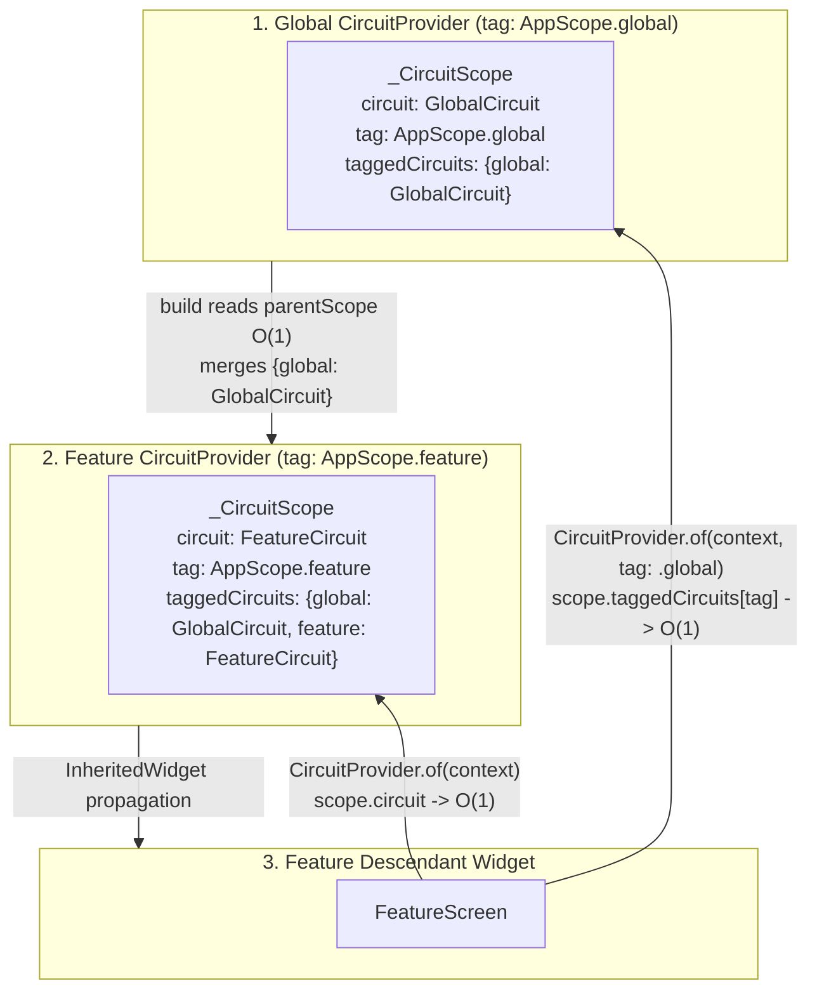

# Circuitry Architecture

## Current Shape & Monorepo Layout

Circuitry is architected as an offline, zero-codegen runtime dependency graph compiler split into three packages under a unified Dart workspace:

```
circuitry/
├── packages/
│   ├── circuitry/                 # Pure Dart runtime dependency injection engine (~28 KB)
│   │   ├── lib/
│   │   │   ├── circuitry.dart     # Library entry point (wires, circuit, exceptions, registry)
│   │   │   └── src/               # Modular source files
│   │   │       ├── circuit.dart   # Circuit container and runtime lifecycle
│   │   │       ├── exceptions.dart# CircuitException hierarchy with primary constructors
│   │   │       ├── extensions.dart# WireKeyFormatting extension
│   │   │       ├── graph.dart     # CircuitGraph: DAG compiler, static validation, wave precomputation, reverse index
│   │   │       ├── introspection.dart # CircuitIntrospection, WireDescriptor, Mermaid/JSON export
│   │   │       ├── registry.dart  # CircuitRegistry, CircuitDescriptor, VM Service extensions
│   │   │       ├── utils.dart     # Internal formatting and utility functions
│   │   │       └── wire.dart      # WireKey, CircuitWire, Wire, AsyncWire, TriggerWire, CircuitAction, builders
│   │   └── test/                  # Unit tests (DAG validation, waves, laziness, disposal, registry)
│   ├── circuitry_devtools_extension/ # Standalone Flutter Web DevTools extension UI & companion package
│   │   ├── extension/             # Dart & Flutter DevTools extension configuration
│   │   │   └── devtools/
│   │   │       ├── build/         # Compiled Flutter Web extension bundle
│   │   │       └── config.yaml
│   │   ├── lib/
│   │   │   ├── circuitry_devtools_extension.dart # Public registration entry point
│   │   │   ├── main.dart          # DevToolsExtension web entry point
│   │   │   └── src/
│   │   │       ├── controllers/   # CircuitryDevToolsController state manager
│   │   │       ├── models/        # CircuitSummary, WireNode, CircuitGraphData, CircuitLifecycleStatus
│   │   │       ├── registration.dart # Explicit VM Service extension registration & deregistration
│   │   │       ├── screens/       # CircuitryDevToolsScreen dashboard root
│   │   │       ├── services/      # CircuitryServiceClient seam (VM & Mock clients)
│   │   │       └── widgets/       # Navigator, DagCanvas, WireDetailDrawer, WaveWaterfallProfiler, Toolbar
│   │   └── test/                  # Model, controller, widget, and registration test suite
│   └── circuitry_flutter/         # Flutter framework bridge
│       ├── lib/
│       │   ├── circuitry_flutter.dart # Library entry point and pure Dart re-export
│       │   └── src/               # Flutter bridge implementation
│       │       ├── circuit_provider.dart # CircuitProvider widget declarations and internal _CircuitScope
│       │       └── circuit_state.dart    # CircuitState sealed hierarchy
│       └── test/                  # Widget & lifecycle tests
├── docs/
│   ├── decisions.md               # Architectural decision records
│   ├── architecture.md            # Detailed system architecture, seams, and module tree
│   └── plan.md                    # Active roadmap and implementation checklist
├── .github/workflows/ci.yml       # Automated format, analyze, and test verification
├── analysis_options.yaml          # Strict static analysis configuration
├── pubspec.yaml                   # Root pub workspace
└── README.md
```

---

## Visual Architecture




---

## Seams, Layer Boundaries & Decoupling Principles

### 1. Pure Dart Engine Independence
- `packages/circuitry` is completely decoupled from the Flutter SDK and UI frameworks.
- Imports strictly from `dart:core` and `dart:async`.
- Usable across all Dart deployment targets: command-line utilities, backend microservices, server frameworks (Shelf, Dart Frog), web apps, and native apps.

### 2. Flutter Framework Bridge
- `packages/circuitry_flutter` imports `circuitry` and `package:flutter/widgets.dart` / `package:flutter/foundation.dart`.
- Re-exports `package:circuitry/circuitry.dart` so Flutter consumers need only depend on `circuitry_flutter`.
- Encapsulates `InheritedWidget` scoping within `_CircuitScope`, preventing `BuildContext` extension pollution.
- Implements `didUpdateWidget` epoch generation tracking to safely cancel and tear down superseded in-flight compilations when wire inputs change.
- Exposes an optional `listener: (context, state)` callback on `CircuitProvider` to execute one-off side effects (snackbars, navigation, telemetry) on state transitions without violating Flutter layout invariants.
- Provides `CircuitBuilder<T>` (and `CircuitBuilder<T>.tagged`) to localize dependency extraction to leaf widgets without full-screen rebuilds or `CircuitProvider.of` boilerplate.
- Propagates tagged ancestor circuits via ambient immutable map merging in `_CircuitScope`, enabling descendants across nested scopes to access tagged ancestor circuits in **O(1)** without tree walking.

### 3. Nested Scopes & O(1) Ambient Registry Map Merging
When `CircuitProvider` widgets are nested (e.g., global app provider -> feature provider), descendants often need access to both their local feature container and ancestor containers:
- `CircuitProvider(tag: AppScope.global, ...)` and `CircuitProvider.value(tag: AppScope.feature, ...)` accept an optional `Enum? tag`.
- Each `_CircuitScope` maintains an immutable `Map<Enum, Circuit> taggedCircuits` map, wrapping merged registries in `Map.unmodifiable`. When `tag` is omitted, parent maps are reused directly without allocations:
  ```dart
  final effectiveTaggedCircuits = parentScope?.taggedCircuits ?? const {};
  taggedCircuits: tag != null
      ? Map.unmodifiable(<Enum, Circuit>{
          ...effectiveTaggedCircuits,
          tag!: circuit,
        })
      : effectiveTaggedCircuits,
  ```
- Descendants access containers with true O(1) performance:
  - `CircuitProvider.of(context)`: returns nearest `Circuit` in **O(1)**.
  - `CircuitProvider.of(context, tag: AppScope.global)`: retrieves `scope.taggedCircuits[tag]` in **O(1)**.
- If two nested providers share the same tag, the nearer ancestor lexically shadows the outer ancestor.
- Sibling subtrees maintain isolated registries without leaking into each other.
- When an inner `CircuitProvider` is in `CircuitBuilding` or `CircuitFailure`, it mounts `_CircuitScope(circuit: null, taggedCircuits: parentScope.taggedCircuits)` to properly intercept untagged lookups (returning `null` in `maybeOf` and throwing `StateError` in `of` rather than leaking the outer ancestor circuit) while continuing to provide access to ready ancestor tagged circuits in O(1).



### 4. Record Tuple Keys (`WireKey = (Type, Enum?)`) & Hot-Path Type-Indexed Retrieval
- Dependency identifiers are Dart 3 record tuples.
- Untagged dependencies use `(T, null)`.
- Tagged dependencies constrain tags to enum values (`(T, K)` where `K extends Enum`).
- Enables Dart dot-shorthands (e.g. `tag: .prod`, `tag: .fast`) and allows multiple distinct registrations of the same generic Dart type without collisions.
- **Type-Indexed Fast Path**: To eliminate record tuple allocation overhead on hot paths, `Circuit` maintains an internal `Map<Type, Object?> _untaggedInstances` fast-path index alongside `_instances`. Calls to `circuit.get<T>()` query `_untaggedInstances[T]` directly in a single hash lookup with zero record allocations, delivering >30M ops/sec with ~30 ns lookup latency. Tagged queries (`getTagged<T, K>(tag)`) use single-hash lookup assignment on `_instances[(T, tag)]`.

### 5. Declarative Wire Recipes (`CircuitWire`, `Wire<T>`, `AsyncWire<T>`, `TriggerWire<T extends CircuitAction>`)
- `Wire<T>`: Synchronous lazy singletons, constructed on first read or when required by an `AsyncWire` during build.
- `AsyncWire<T>`: Asynchronous singletons resolved in parallel topological waves during `Circuit.build(wires)`.
- `TriggerWire<T extends CircuitAction>`: Actionable, callable singletons enforcing that `T` implements the `CircuitAction` blueprint marker interface at compile time. Instantiated lazily on first read, memoized in container storage for O(1) subsequent access without recreation/GC churn, and callable using native Dart `call(...)` syntax.
- Fluent accumulator chaining (`Wire.takes`, `AsyncWire.takes`, `TriggerWire.takes` backed by internal `WireBuilder` / `AsyncWireBuilder` / `TriggerWireBuilder` hidden from public exports) allows type-safe dependency declarations:
  - 1-dependency accumulator passes directly to 1-arg constructor/tear-off (`.to(UserService.new)`).
  - Multi-dependency accumulator unpacks nested record tuples (`(deps) => OrderService(deps.$1, deps.$2)`).

### 6. DAG Static Validation & Parallel Topological Wave Resolution
- `Circuit.build(wires)` instantiates `CircuitGraph(wires)..compile()` to execute full DAG validation before instantiation:
  - Duplicate keys throw `DuplicateWireException`
  - Missing dependencies throw `MissingWireException`
  - Cycles throw `CircularDependencyException` with cycle paths
- `CircuitGraph` exposes validation methods (`validateDuplicates()`, `validateDependencies()`, `detectCycles()`, `computeTopologicalLevels()`) for isolated testing and maintenance.
- Precomputes topological levels and wave buckets (`wiresByLevel`, `asyncWiresByLevel`) in `CircuitGraph` during `compile()` for O(1) wave access.
- Resolves `AsyncWire`s in parallel topological waves using `Future.wait` with fail-fast semantics (`eagerError: true`). Immediately aborts wave execution and tears down partially initialized instances in reverse topological order upon the first failure, safely disposing late-completing in-flight async singletons.

### 7. Reverse Topological Wave Disposal
- `Circuit.dispose()` performs idempotent teardown in reverse topological dependency waves (`leaves -> roots`), ensuring consumers are disposed before their underlying dependencies.
- Executes `onDispose` callbacks concurrently across each level, aggregating failures into `DisposalException`. Subsequent calls are safe no-ops.

### 8. Introspection & Reverse Adjacency Querying (Issue #4)
- `CircuitGraph` precomputes an unmodifiable `reverseDependencies` map (`depKey -> dependents`) during `compile()`, enabling instant O(1) direct dependent lookups and iterative BFS transitive resolution via `dependentsOf(key, {bool transitive = false})` and `dependenciesOf(key, {bool transitive = false})`.
- `circuit.inspect()` returns an immutable `CircuitIntrospection` snapshot capturing `WireDescriptor` states (`isInitialized`, `isAsync`, `topologicalLevel`), wave groupings (`waves`), `maxWaveLevel`, and `topologicalOrder`.
- Exports valid `flowchart TD` Mermaid markup via `toMermaid({bool showStatus = true, bool groupByWave = true})` with wave subgraphs and initialization styling, plus structured `toJson()` data serialization.
- Zero runtime or memory overhead when uninspected; 100% tree-shaken by the Dart compiler in production release builds.

### 9. DevTools Integration & Ambient Registry (Issue #11)
- `CircuitRegistry` in `src/registry.dart` tracks live `Circuit` instances and optional `debugTag` exclusively in debug mode. In profile and release modes (when assertions are disabled), `debugTag`, `CircuitRegistry`, and all its methods and properties are complete no-ops, with VM service extensions omitted and telemetry calls tree-shaken by the compiler for zero memory and runtime overhead.
- Standard Dart VM Service extensions (`ext.circuitry.getCircuits`, `ext.circuitry.getCircuitGraph`, `ext.circuitry.forceResolveWire`) are registered via `dart:developer` through explicit registration methods (`CircuitRegistry.instance.registerVmServiceExtensions()`). External DevTools clients query container states and DAG graphs over the wire and force on-demand singleton initialization.
- Calling `CircuitRegistry.instance.unregisterVmServiceExtensions()` disables active extension invocation responses and silences live event streams.
- Real-time container lifecycle events (`circuit_building`, `circuit_ready`, `circuit_failed`, `circuit_disposed`, `wire_resolved`) are streamed to the `'Circuitry'` extension stream via `developer.postEvent`.
- Automatic extension registration has been decoupled from `packages/circuitry` and `packages/circuitry_flutter` so the core DI engine remains an ultra-lightweight (~28 KB) pure Dart package without embedding a 15 MB DevTools web bundle.

### 10. DevTools Extension UI: Interactive DAG Visualizer & Wave Waterfall Profiler (Issue #5)
- Published as an optional opt-in companion package `circuitry_devtools_extension` (added under `dev_dependencies`).
- Contains the compiled Flutter Web extension bundle in `packages/circuitry_devtools_extension/extension/devtools/` and `config.yaml` so DevTools loads the extension tab seamlessly only when developers opt into it.
- Exposes `registerCircuitryDevToolsExtension()` and `unregisterCircuitryDevToolsExtension()` (or `CircuitryDevTools.register()` / `CircuitryDevTools.unregister()`) for explicit opt-in enablement in application entry points (`main()`).
- Implemented using `package:devtools_extensions` and `package:devtools_app_shared`.
- Decouples UI rendering from the VM Service transport via the `CircuitryServiceClient` interface, with `VmCircuitryServiceClient` communicating over Dart VM Service protocol and `MockCircuitryServiceClient` providing offline testing and preview capabilities.
- **Circuit Navigator:** Multi-scope sidebar listing detected containers with tag badges (`[tag: AppScope.global]`), lifecycle state badges (`Ready`, `Building`, `Failed`, `Disposed`), and wire initialization counters.
- **Interactive DAG Canvas:** Arranges dependency nodes horizontally in distinct columns by topological wave level (Wave 0 roots to Wave $N$ consumers). Connects dependencies with smooth cubic Bézier splines via `CustomPainter`, illuminating upstream dependencies (blue) and downstream dependents (purple) upon node selection while dimming unrelated graph elements.
- **Node Anatomy & Status Styling:** Differentiates resolved singletons (green checkmark), sleeping lazy wires (dashed border), in-flight async wires (amber spinner), and compilation failures (crimson error).
- **Wire Detail Drawer & Live Actions:** Displays full wire metadata, wave level, interactive dependency links, and a "Force Initialize" action triggering `ext.circuitry.forceResolveWire` to instantiate sleeping lazy singletons in real time.
- **Startup Wave Waterfall Profiler:** Renders a Gantt timeline of parallel wave execution during `Circuit.build(wires)`, pinpointing startup latency bottlenecks and highlighting the critical path.
- **Toolbar & Exporters:** Provides debounced (150ms) search filtering by type or tag, status filters (`Unresolved Only`, `Async Only`, `Critical Path`), view mode switching, and multi-format diagram export (Mermaid flowchart, JSON schema, and SVG markup).
- **High-Performance Rendering Architecture:**
  - **Background Isolate Offloading:** Offloads incoming DAG JSON graph deserialization and diagram/SVG exporters to background workers/isolates via Flutter foundation `compute()`, ensuring the main UI thread never blocks during payload processing.
  - **Pre-Computed Geometry & Zero-Allocation Splines:** Caches layout calculations in `_DagCanvasLayout`. Bézier spline paths are pre-constructed once per graph update; interactive pan and zoom gestures inside `InteractiveViewer` allocate zero `Path` or `Paint` objects per frame, sustaining 60/120 FPS.
  - **Batched Canvas Draw Calls:** Unselected graph edges render in a single `canvas.drawPath` call using a combined path; wire selections batch dimmed edges into a single path, minimizing GPU state switches.
  - **Fine-Grained Scoped Rebuilding & Paint Isolation:** Scopes controller updates to individual panes and wraps all split panes (`CircuitNavigator`, `DevToolsAreaPane`, `WireDetailDrawer`, and `DevToolsToolbar`) and `InteractiveViewer` in `RepaintBoundary` layers, eliminating full-scaffold redraws during canvas interaction or live typing.
- Compiled via `dart run devtools_extensions build_and_copy` into `packages/circuitry_devtools_extension/extension/devtools/build/`.

---

## Verification & Commands

For workspace formatting, static analysis, and test commands, see [README.md#verification--commands](../README.md#verification--commands).
