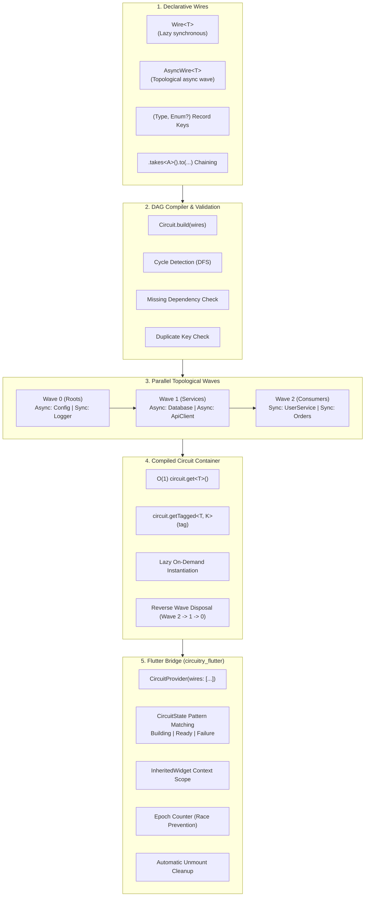
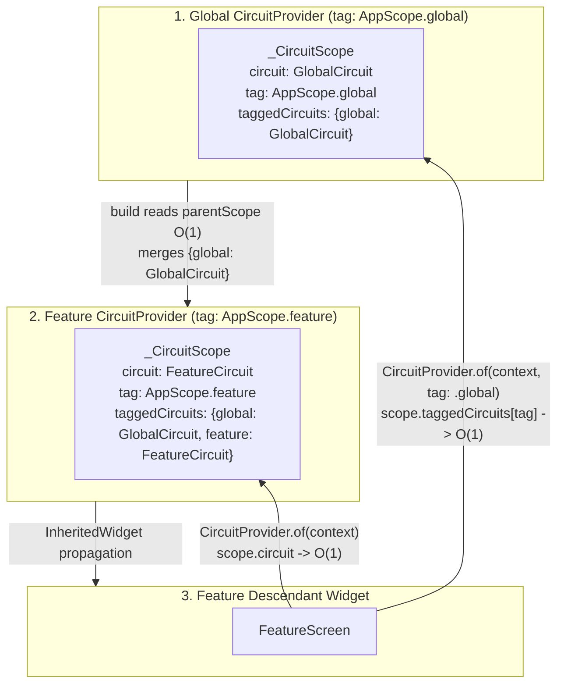

# Circuitry Architecture

## Current Shape & Monorepo Layout

Circuitry is architected as an offline, zero-codegen runtime dependency graph compiler split into two packages under a unified Dart workspace:

```
circuitry/
├── packages/
│   ├── circuitry/                 # Pure Dart runtime dependency injection engine
│   │   ├── extension/             # Dart & Flutter DevTools extension configuration
│   │   │   └── devtools/
│   │   │       └── config.yaml
│   │   ├── lib/
│   │   │   ├── circuitry.dart     # Library entry point (wires, circuit, exceptions, registry)
│   │   │   └── src/               # Modular source files
│   │   │       ├── circuit.dart   # Circuit container and runtime lifecycle
│   │   │       ├── exceptions.dart# CircuitException hierarchy with primary constructors
│   │   │       ├── extensions.dart# WireKeyFormatting extension
│   │   │       ├── graph.dart     # CircuitGraph: DAG compiler, static validation, wave precomputation, reverse index
│   │   │       ├── introspection.dart # CircuitIntrospection, WireDescriptor, Mermaid/JSON export
│   │   │       ├── registry.dart  # CircuitRegistry, CircuitDescriptor, VM Service extensions
│   │   │       ├── utils.dart     # Internal formatting and utility functions
│   │   │       └── wire.dart      # WireKey, CircuitWire, Wire, AsyncWire, builders
│   │   └── test/                  # Unit tests (DAG validation, waves, laziness, disposal, registry)
│   └── circuitry_flutter/         # Flutter framework bridge
│       ├── lib/
│       │   ├── circuitry_flutter.dart # Library entry point and pure Dart re-export
│       │   └── src/               # Flutter bridge implementation
│       │       ├── circuit_provider.dart # CircuitProvider widget declarations and internal _CircuitScope
│       │       └── circuit_state.dart    # CircuitState sealed hierarchy
│       └── test/                  # Widget & lifecycle tests
├── docs/
│   ├── decisions.md               # Architectural decision records
│   ├── architecture.md            # Detailed system architecture, seams, and module tree
│   └── plan.md                    # Active roadmap and implementation checklist
├── .github/workflows/ci.yml       # Automated format, analyze, and test verification
├── analysis_options.yaml          # Strict static analysis configuration
├── pubspec.yaml                   # Root pub workspace
└── README.md
```

---

## Visual Architecture




---

## Seams, Layer Boundaries & Decoupling Principles

### 1. Pure Dart Engine Independence
- `packages/circuitry` is completely decoupled from the Flutter SDK and UI frameworks.
- Imports strictly from `dart:core` and `dart:async`.
- Usable across all Dart deployment targets: command-line utilities, backend microservices, server frameworks (Shelf, Dart Frog), web apps, and native apps.

### 2. Flutter Framework Bridge
- `packages/circuitry_flutter` imports `circuitry` and `package:flutter/widgets.dart` / `package:flutter/foundation.dart`.
- Re-exports `package:circuitry/circuitry.dart` so Flutter consumers need only depend on `circuitry_flutter`.
- Encapsulates `InheritedWidget` scoping within `_CircuitScope`, preventing `BuildContext` extension pollution.
- Implements `didUpdateWidget` epoch generation tracking to safely cancel and tear down superseded in-flight compilations when wire inputs change.
- Propagates tagged ancestor circuits via ambient immutable map merging in `_CircuitScope`, enabling descendants across nested scopes to access tagged ancestor circuits in **O(1)** without tree walking.

### 3. Nested Scopes & O(1) Ambient Registry Map Merging
When `CircuitProvider` widgets are nested (e.g., global app provider -> feature provider), descendants often need access to both their local feature container and ancestor containers:
- `CircuitProvider(tag: AppScope.global, ...)` and `CircuitProvider.value(tag: AppScope.feature, ...)` accept an optional `Enum? tag`.
- Each `_CircuitScope` maintains an immutable `Map<Enum, Circuit> taggedCircuits` map, wrapping merged registries in `Map.unmodifiable`. When `tag` is omitted, parent maps are reused directly without allocations:
  ```dart
  final effectiveTaggedCircuits = parentScope?.taggedCircuits ?? const {};
  taggedCircuits: tag != null
      ? Map.unmodifiable(<Enum, Circuit>{
          ...effectiveTaggedCircuits,
          tag!: circuit,
        })
      : effectiveTaggedCircuits,
  ```
- Descendants access containers with true O(1) performance:
  - `CircuitProvider.of(context)`: returns nearest `Circuit` in **O(1)**.
  - `CircuitProvider.of(context, tag: AppScope.global)`: retrieves `scope.taggedCircuits[tag]` in **O(1)**.
- If two nested providers share the same tag, the nearer ancestor lexically shadows the outer ancestor.
- Sibling subtrees maintain isolated registries without leaking into each other.
- When an inner `CircuitProvider` is in `CircuitBuilding` or `CircuitFailure`, it mounts `_CircuitScope(circuit: null, taggedCircuits: parentScope.taggedCircuits)` to properly intercept untagged lookups (returning `null` in `maybeOf` and throwing `StateError` in `of` rather than leaking the outer ancestor circuit) while continuing to provide access to ready ancestor tagged circuits in O(1).



### 4. Record Tuple Keys (`WireKey = (Type, Enum?)`)
- Dependency identifiers are Dart 3 record tuples.
- Untagged dependencies use `(T, null)`.
- Tagged dependencies constrain tags to enum values (`(T, K)` where `K extends Enum`).
- Enables Dart dot-shorthands (e.g. `tag: .prod`, `tag: .fast`) and allows multiple distinct registrations of the same generic Dart type without collisions.

### 5. Declarative Wire Recipes (`CircuitWire`, `Wire<T>`, `AsyncWire<T>`)
- `Wire<T>`: Synchronous lazy singletons, constructed on first read or when required by an `AsyncWire` during build.
- `AsyncWire<T>`: Asynchronous singletons resolved in parallel topological waves during `Circuit.build(wires)`.
- Fluent accumulator chaining (`Wire.takes`, `AsyncWire.takes` backed by internal `WireBuilder` / `AsyncWireBuilder` hidden from public exports) allows type-safe dependency declarations:
  - 1-dependency accumulator passes directly to 1-arg constructor/tear-off (`.to(UserService.new)`).
  - Multi-dependency accumulator unpacks nested record tuples (`(deps) => OrderService(deps.$1, deps.$2)`).

### 6. DAG Static Validation & Parallel Topological Wave Resolution
- `Circuit.build(wires)` instantiates `CircuitGraph(wires)..compile()` to execute full DAG validation before instantiation:
  - Duplicate keys throw `DuplicateWireException`
  - Missing dependencies throw `MissingWireException`
  - Cycles throw `CircularDependencyException` with cycle paths
- `CircuitGraph` exposes validation methods (`validateDuplicates()`, `validateDependencies()`, `detectCycles()`, `computeTopologicalLevels()`) for isolated testing and maintenance.
- Precomputes topological levels and wave buckets (`wiresByLevel`, `asyncWiresByLevel`) in `CircuitGraph` during `compile()` for O(1) wave access.
- Resolves `AsyncWire`s in parallel topological waves using `Future.wait` with fail-fast semantics (`eagerError: true`). Immediately aborts wave execution and tears down partially initialized instances in reverse topological order upon the first failure, safely disposing late-completing in-flight async singletons.

### 7. Reverse Topological Wave Disposal
- `Circuit.dispose()` performs idempotent teardown in reverse topological dependency waves (`leaves -> roots`), ensuring consumers are disposed before their underlying dependencies.
- Executes `onDispose` callbacks concurrently across each level, aggregating failures into `DisposalException`. Subsequent calls are safe no-ops.

### 8. Introspection & Reverse Adjacency Querying (Issue #4)
- `CircuitGraph` precomputes an unmodifiable `reverseDependencies` map (`depKey -> dependents`) during `compile()`, enabling instant O(1) direct dependent lookups and iterative BFS transitive resolution via `dependentsOf(key, {bool transitive = false})` and `dependenciesOf(key, {bool transitive = false})`.
- `circuit.inspect()` returns an immutable `CircuitIntrospection` snapshot capturing `WireDescriptor` states (`isInitialized`, `isAsync`, `topologicalLevel`), wave groupings (`waves`), `maxWaveLevel`, and `topologicalOrder`.
- Exports valid `flowchart TD` Mermaid markup via `toMermaid({bool showStatus = true, bool groupByWave = true})` with wave subgraphs and initialization styling, plus structured `toJson()` data serialization.
- Zero runtime or memory overhead when uninspected; 100% tree-shaken by the Dart compiler in production release builds.

### 9. DevTools Integration & Ambient Registry (Issue #11)
- `CircuitRegistry` in `src/registry.dart` tracks live `Circuit` instances and optional `debugTag` exclusively in debug mode. In profile and release modes (when assertions are disabled), `debugTag`, `CircuitRegistry`, and all its methods and properties are complete no-ops, with VM service extensions omitted and telemetry calls tree-shaken by the compiler for zero memory and runtime overhead.
- Standard Dart VM Service extensions (`ext.circuitry.getCircuits`, `ext.circuitry.getCircuitGraph`) registered using `dart:developer` allow external DevTools clients to query container states and DAG graphs over the wire.
- Real-time container lifecycle events (`circuit_building`, `circuit_ready`, `circuit_failed`, `circuit_disposed`, `wire_resolved`) are streamed to the `'Circuitry'` extension stream via `developer.postEvent`.
- `packages/circuitry/extension/devtools/config.yaml` declares DevTools extension integration, providing universal inspection across CLI tools, backend microservices, and Flutter applications (via transitive dependency) with zero Flutter dependencies in the engine.

---

## Verification & Commands

For workspace formatting, static analysis, and test commands, see [README.md#verification--commands](../README.md#verification--commands).
