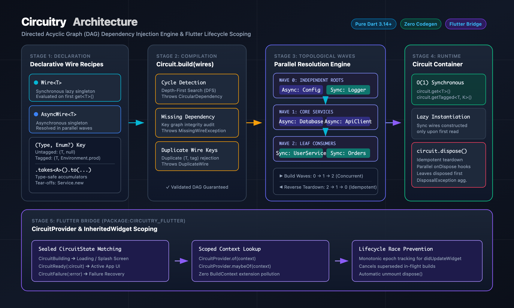
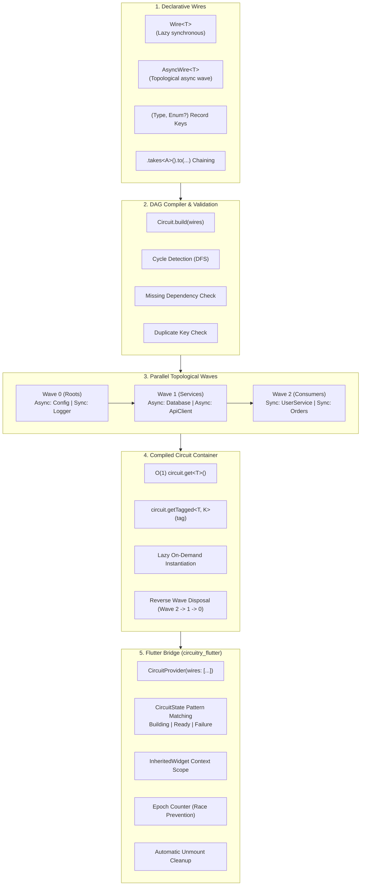

# Circuitry Architecture

## Current Shape & Monorepo Layout

Circuitry is architected as an offline, zero-codegen runtime dependency graph compiler split into two packages under a unified Dart workspace:

```
circuitry/
├── packages/
│   ├── circuitry/                 # Pure Dart runtime dependency injection engine
│   │   ├── lib/
│   │   │   ├── circuitry.dart     # Library entry point (wires, circuit, exceptions)
│   │   │   └── src/               # Modular source files
│   │   │       ├── circuit.dart   # Circuit container and DAG compiler
│   │   │       ├── exceptions.dart# CircuitException hierarchy with primary constructors
│   │   │       └── wire.dart      # WireKey, CircuitWire, Wire, AsyncWire, builders
│   │   └── test/                  # Unit tests (DAG validation, waves, laziness, disposal)
│   └── circuitry_flutter/         # Flutter framework bridge
│       ├── lib/
│       │   ├── circuitry_flutter.dart # Library entry point and pure Dart re-export
│       │   └── src/               # Flutter bridge implementation
│       │       ├── circuit_provider.dart # CircuitProvider widget declarations and internal _CircuitScope
│       │       └── circuit_state.dart    # CircuitState sealed hierarchy
│       └── test/                  # Widget & lifecycle tests
├── docs/
│   ├── decisions.md               # Architectural decision records
│   ├── architecture.md            # Detailed system architecture, seams, and module tree
│   └── plan.md                    # Active roadmap and implementation checklist
├── .github/workflows/ci.yml       # Automated format, analyze, and test verification
├── analysis_options.yaml          # Strict static analysis configuration
├── pubspec.yaml                   # Root pub workspace
└── README.md
```

---

## Visual Architecture





---

## Seams, Layer Boundaries & Decoupling Principles

### 1. Pure Dart Engine Independence
- `packages/circuitry` is completely decoupled from the Flutter SDK and UI frameworks.
- Imports strictly from `dart:core` and `dart:async`.
- Usable across all Dart deployment targets: command-line utilities, backend microservices, server frameworks (Shelf, Dart Frog), web apps, and native apps.

### 2. Flutter Framework Bridge
- `packages/circuitry_flutter` imports `circuitry` and `package:flutter/widgets.dart` / `package:flutter/foundation.dart`.
- Re-exports `package:circuitry/circuitry.dart` so Flutter consumers need only depend on `circuitry_flutter`.
- Encapsulates `InheritedWidget` scoping within `CircuitScope`, preventing `BuildContext` extension pollution.
- Implements `didUpdateWidget` epoch generation tracking to safely cancel and tear down superseded in-flight compilations when wire inputs change.

### 3. Record Tuple Keys (`WireKey = (Type, Enum?)`)
- Dependency identifiers are Dart 3 record tuples.
- Untagged dependencies use `(T, null)`.
- Tagged dependencies constrain tags to enum values (`(T, K)` where `K extends Enum`).
- Enables Dart dot-shorthands (e.g. `tag: .prod`, `tag: .fast`) and allows multiple distinct registrations of the same generic Dart type without collisions.

### 4. Declarative Wire Recipes (`CircuitWire`, `Wire<T>`, `AsyncWire<T>`)
- `Wire<T>`: Synchronous lazy singletons, constructed on first read or when required by an `AsyncWire` during build.
- `AsyncWire<T>`: Asynchronous singletons resolved in parallel topological waves during `Circuit.build(wires)`.
- Fluent accumulator chaining (`Wire.takes`, `AsyncWire.takes` backed by internal `WireBuilder` / `AsyncWireBuilder` hidden from public exports) allows type-safe dependency declarations:
  - 1-dependency accumulator passes directly to 1-arg constructor/tear-off (`.to(UserService.new)`).
  - Multi-dependency accumulator unpacks nested record tuples (`(deps) => OrderService(deps.$1, deps.$2)`).

### 5. DAG Static Validation & Parallel Topological Wave Resolution
- `Circuit.build(wires)` executes full DAG validation before instantiation:
  - Duplicate keys throw `DuplicateWireException`
  - Missing dependencies throw `MissingWireException`
  - Cycles throw `CircularDependencyException` with cycle paths
- Resolves `AsyncWire`s in parallel topological waves using `Future.wait`. Automatically tears down partially initialized instances in reverse topological order if any wave throws.

### 6. Reverse Topological Wave Disposal
- `Circuit.dispose()` performs idempotent teardown in reverse topological dependency waves (`leaves -> roots`), ensuring consumers are disposed before their underlying dependencies.
- Executes `onDispose` callbacks concurrently across each level, aggregating failures into `DisposalException`. Subsequent calls are safe no-ops.

### 7. Package Metadata & pub.dev Discovery
- Centralizes project links on `https://github.com/maranix/circuitry` with issues routed to package-specific label queries (`label:circuitry` and `label:circuitry_flutter`).
- Subpackage repository fields are deep-linked to their tree directories (`packages/circuitry` and `packages/circuitry_flutter`) to enable direct file browsing from pub.dev.
- Curates up to 5 lowercase slug discovery topics per package targeting DI, IoC, DAG, Flutter, and architectural workflows.
- Maintains standalone `CHANGELOG.md` and MIT `LICENSE` files within each package to satisfy pub publishing requirements.

---

## Verification & Commands

```bash
# Workspace format check
dart format --output=none --set-exit-if-changed .

# Workspace static analysis
flutter analyze --fatal-infos --fatal-warnings

# Run all unit tests for pure Dart circuitry
cd packages/circuitry && dart test

# Run all widget & lifecycle tests for circuitry_flutter
cd packages/circuitry_flutter && flutter test
```
