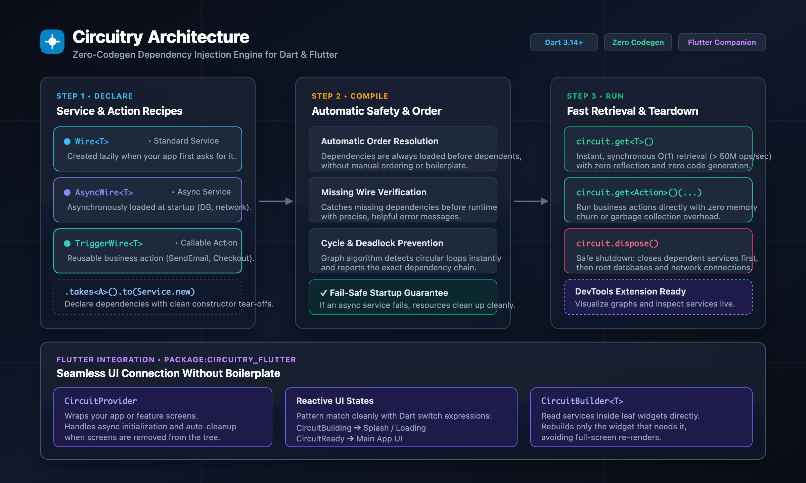

# Circuitry

[](https://pub.dev/packages/circuitry)
[](LICENSE)

A pure Dart 3.14+ zero-codegen, graph-based dependency injection engine backed by a Directed Acyclic Graph (DAG).

Circuitry provides compile-time-checked runtime dependency wiring with parallel topological wave resolution for asynchronous singletons, reverse topological wave disposal, and type-safe dependency chaining without code generation or reflection.

---

## Architecture Overview



---

## Features

- **Zero-Codegen & Reflection-Free**: Pure modern Dart 3.14+ utilizing primary constructors, pattern matching, and record tuples `(Type, Enum?)` as wire keys.
- **DAG Static Validation**: Validates the dependency graph during `Circuit.build(wires)`:
  - Detects duplicate wire keys (`DuplicateWireException`)
  - Identifies missing dependencies (`MissingWireException`)
  - Detects dependency cycles with exact cycle paths (`CircularDependencyException`)
- **Parallel Topological Wave Resolution**: Resolves asynchronous singletons (`AsyncWire<T>`) concurrently level-by-level using `Future.wait` with fail-fast semantics (`eagerError: true`). Immediately rolls back and tears down partially created singletons if any wave fails.
- **Type-Safe Accumulator Chaining**: Declare dependencies using `takes<A>()` and `takesTagged<B, K>(tag)`. Supports direct tear-offs (`.to(UserService.new)`) and destructuring nested tuples for multiple dependencies.
- **Dot-Shorthand Tagging**: Supports tagged dependencies with Dart enum dot-shorthands (e.g. `tag: .prod`, `tag: .fast`), enabling multiple distinct singletons of the same generic Dart type without collisions.
- **Reverse Topological Wave Disposal**: Idempotent teardown in reverse dependency waves (`leaves -> roots`), running parallel asynchronous `onDispose` callbacks and aggregating errors into `DisposalException`.
- **On-Demand Introspection & Exporters**: Query direct and transitive dependents (`circuit.inspect().dependentsOf(key)`), inspect topological waves, and generate Mermaid diagrams (`toMermaid()`) or JSON schemas (`toJson()`). Fully tree-shaken in release builds when unused.
- **DevTools Integration & Universal Extension Host**: Ambient `CircuitRegistry` tracks containers in debug mode and exposes VM Service endpoints (`ext.circuitry.getCircuits`, `ext.circuitry.getCircuitGraph`, `ext.circuitry.forceResolveWire`). In profile and release modes, registry tracking and `debugTag` are complete no-ops and tree-shaken with zero runtime or memory overhead. Preconfigured DevTools extension provides auto-discovery across CLI, backend, and Flutter apps.

---

## Installation

```bash
dart pub add circuitry
```

---

## Quickstart

### 1. Define Dependencies

```dart
import 'package:circuitry/circuitry.dart';

enum Environment { dev, prod }

final class const DatabaseConfig(final String path);

final class DatabaseService(final DatabaseConfig config) {
  Future<void> close() async {}
}

final class UserService(final DatabaseService db);
```

### 2. Declare Wires

```dart
// Synchronous wire with tagged enum
final configWire = Wire.tag(
  () => const DatabaseConfig('app.db'),
  tag: Environment.prod,
);

// Asynchronous wire depending on tagged config with disposal hook
final dbWire = AsyncWire.takesTagged<DatabaseConfig, Environment>(Environment.prod).to(
  (config) async => DatabaseService(config),
  onDispose: (service) => service.close(),
);

// Synchronous wire depending on dbWire via tear-off
final userWire = Wire.takes<DatabaseService>().to(UserService.new);
```

### 3. Build & Consume Circuit

```dart
void main() async {
  final circuit = await Circuit.build(
    [
      configWire,
      dbWire,
      userWire,
    ],
    debugTag: 'main_circuit',
  );

  // Synchronous O(1) instance lookup
  final userService = circuit.get<UserService>();

  // Tagged lookup
  final config = circuit.getTagged<DatabaseConfig, Environment>(Environment.prod);

  // On-demand DAG introspection (tree-shaken in release if unused)
  final introspection = circuit.inspect();
  print(introspection.toMermaid());

  // Reverse topological wave teardown (users -> db -> config)
  await circuit.dispose();
}
```

---

## DevTools Extension

To keep `circuitry` ultra-lightweight (~28 KB), the interactive visualizer is distributed as an optional companion package: [`circuitry_devtools_extension`](https://pub.dev/packages/circuitry_devtools_extension).

### Opt-in Setup

1. Add `circuitry_devtools_extension` to your `dev_dependencies`:
```yaml
dev_dependencies:
  circuitry_devtools_extension: ^0.2.0
```

2. Register the extension in your application entry point during debug mode:
```dart
import 'package:circuitry/circuitry.dart';
import 'package:circuitry_devtools_extension/circuitry_devtools_extension.dart';

void main() async {
  assert(() {
    registerCircuitryDevToolsExtension();
    return true;
  }());

  final circuit = await Circuit.build([...]);
  // ...
}
```

3. Launch your app in debug mode and open Dart DevTools in your browser or IDE.
4. Select the **Circuitry** tab to explore the interactive DAG canvas, horizontal topological wave columns, cubic Bézier dependency edge splines, startup wave waterfall profiler with critical path calculation, and on-demand wire initialization.

In profile and release modes, DevTools VM Service extensions and ambient tracking are completely disabled and tree-shaken with zero runtime overhead.

---

## Flutter Integration

For Flutter applications, see [`circuitry_flutter`](https://pub.dev/packages/circuitry_flutter), which provides `CircuitProvider`, `CircuitState` pattern matching, and `InheritedWidget` scoping.

---

## License

MIT © [Raman Verma](https://github.com/maranix)
