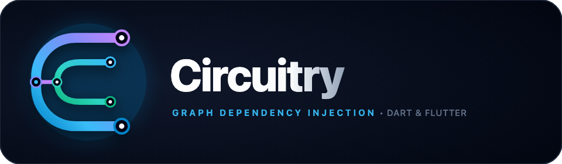
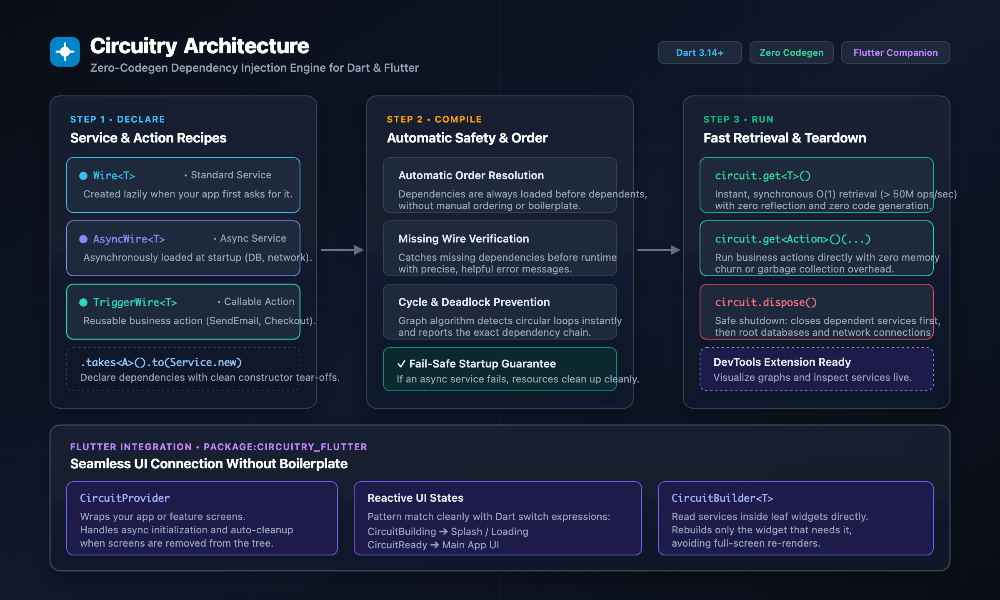

<p align="center">
  
</p>

<p align="center">
  <strong>Flutter bridge for Circuitry — providing InheritedWidget scoping, reactive CircuitState pattern matching, and automatic unmount disposal.</strong>
</p>

<p align="center">
  <a href="https://pub.dev/packages/circuitry_flutter"></a>
  <a href="https://github.com/maranix/circuitry/actions"></a>
  <a href="https://opensource.org/licenses/MIT"></a>
</p>

---

## Architecture Overview



---

## Features

- **Sealed `CircuitState` Hierarchy**: Pattern match `CircuitBuilding`, `CircuitReady`, and `CircuitFailure` using Dart 3 switch expressions.
- **Asynchronous Build Lifecycle (`CircuitProvider`)**: Compiles `CircuitWire` recipes asynchronously, displays loading/splash state while resolving, and wraps child in an internal `InheritedWidget` scope once ready.
- **Monotonic Epoch Race Prevention**: Handles dynamic widget wire updates (`didUpdateWidget`) without race conditions, safely discarding superseded in-flight builds.
- **Automatic Unmount Cleanup**: Automatically calls `circuit.dispose()` when the provider is unmounted from the widget tree.
- **Side-Effect Listener (`CircuitProvider.listener`)**: Execute one-off side effects (snackbars, navigation, error telemetry) on state transitions without polluting widget `builder` methods.
- **Localized Leaf Reads (`CircuitBuilder<T>`)**: Extract dependencies in leaf widgets via `CircuitBuilder<T>` and `CircuitBuilder<T>.tagged`, avoiding broad screen rebuilds.
- **Synchronous Value Injection (`CircuitProvider.value`)**: Injects an already resolved `Circuit` synchronously for test harnesses or sub-trees without managing lifecycle disposal.
- **Taggable Scopes & O(1) Nested Lookup**: Associate providers with tags (`tag: Scope.global`) to retrieve ancestor containers across nested providers in **O(1)** via `CircuitProvider.of(context, tag: Scope.global)` without widget tree walking.
- **DevTools Integration & Debug Tags**: Associate providers with `debugTag: 'root'` to label containers and inspect their DAG, topological waves, and live wire states in the DevTools extension.
- **Explicit Accessors**: Retrieve dependencies via `CircuitProvider.of(context)` and `CircuitProvider.maybeOf(context)` without `BuildContext` extension pollution.

---

## Installation

```bash
flutter pub add circuitry_flutter
```

---

## Quickstart

```dart
import 'package:circuitry_flutter/circuitry_flutter.dart';
import 'package:flutter/widgets.dart';

void main() {
  runApp(const MyApp());
}

class MyApp extends StatelessWidget {
  const MyApp({super.key});

  static final _defaultWires = [
    Wire(() => DatabaseConfig('app.db')),
    AsyncWire.takes<DatabaseConfig>().to(DatabaseManager.open),
  ];

  @override
  Widget build(BuildContext context) {
    return CircuitProvider(
      debugTag: 'root',
      wires: _defaultWires,
      builder: (context, state) => switch (state) {
        CircuitReady(:final circuit) => const HomeScreen(),
        CircuitBuilding() => const SplashScreen(),
        CircuitFailure(:final error) => ErrorScreen(error: error),
      },
    );
  }
}

class HomeScreen extends StatelessWidget {
  const HomeScreen({super.key});

  @override
  Widget build(BuildContext context) {
    final circuit = CircuitProvider.of(context);
    final db = circuit.get<DatabaseService>();

    return Center(
      child: Text('Database active: ${db.path}'),
    );
  }
}
```

---

## Nested Scopes & Tagged Circuit Providers

When nesting providers (e.g. global app scope wrapping feature-specific modules), tag each `CircuitProvider` to allow descendants to access ancestor containers in **O(1)**:

```dart
enum AppScope { global, feature }

class AppRoot extends StatelessWidget {
  const AppRoot({super.key});

  @override
  Widget build(BuildContext context) {
    return CircuitProvider(
      tag: AppScope.global,
      wires: [Wire(GlobalAuthService.new)],
      builder: (context, state) => switch (state) {
        CircuitReady() => CircuitProvider(
          tag: AppScope.feature,
          wires: [Wire(FeatureViewModel.new)],
          builder: (context, state) => switch (state) {
            CircuitReady() => const FeatureScreen(),
            _ => const SplashScreen(),
          },
        ),
        _ => const SplashScreen(),
      },
    );
  }
}

class FeatureScreen extends StatelessWidget {
  const FeatureScreen({super.key});

  @override
  Widget build(BuildContext context) {
    // 1. Nearest circuit (feature):
    final featureCircuit = CircuitProvider.of(context);

    // 2. Ancestor tagged circuit (global) in O(1):
    final globalCircuit = CircuitProvider.of(context, tag: AppScope.global);

    return Text('Feature ready with global auth');
  }
}
```

---

## DevTools Extension

To inspect your Flutter application's dependency graphs in DevTools without bloating production app size, add the optional companion package: [`circuitry_devtools_extension`](https://pub.dev/packages/circuitry_devtools_extension).

### Opt-in Setup

1. Add `circuitry_devtools_extension` to your Flutter app's `dev_dependencies`:
```yaml
dev_dependencies:
  circuitry_devtools_extension: ^0.2.0
```

2. Register the extension in your `main()` function during debug mode:
```dart
import 'package:circuitry_devtools_extension/circuitry_devtools_extension.dart';
import 'package:flutter/foundation.dart';
import 'package:flutter/material.dart';

void main() {
  if (kDebugMode) {
    registerCircuitryDevToolsExtension();
  }
  runApp(const MyApp());
}
```

3. Launch your Flutter app in debug mode and open Flutter DevTools.
4. Switch to the **Circuitry** tab to inspect active containers (labeled by `tag`), visualize the dependency graph across topological waves, review async resolution durations, and force resolve lazy wires on demand.

---

## License

MIT © [Raman Verma](https://github.com/maranix)
